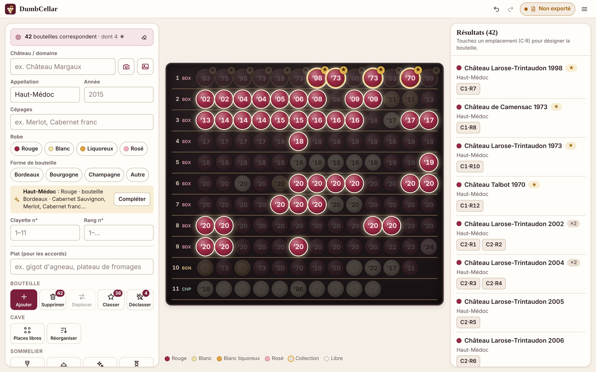
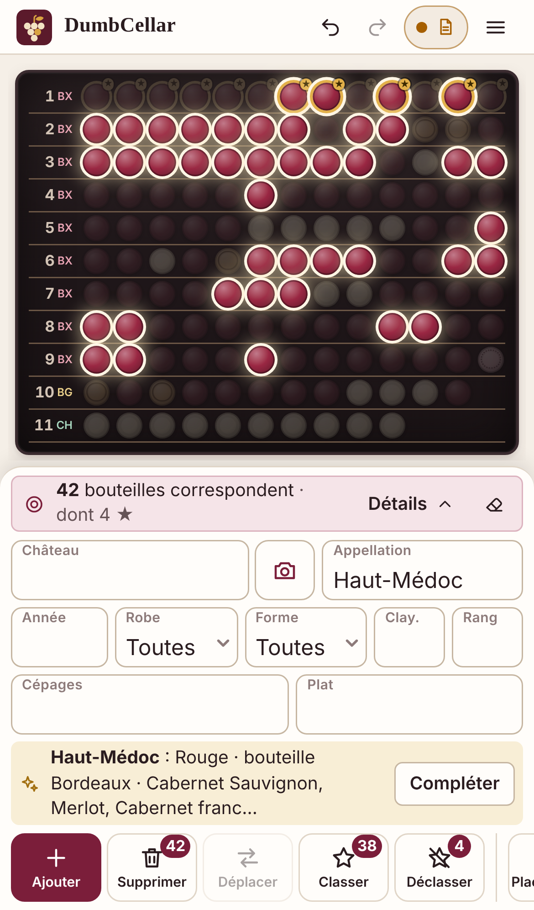

# Bacchus SmartCellar

Application web pour gérer une cave à vin de type **armoire réfrigérée** : un schéma des clayettes toujours à l'écran, un formulaire permanent qui sert à chercher, ajouter et cibler les bouteilles, une réorganisation guidée pas à pas, et un sommelier (base de connaissances embarquée, affinée par l'IA Groq si elle est configurée).

Elle fonctionne sur ordinateur et sur iPhone, s'installe sur l'écran d'accueil (PWA), et reste utilisable hors ligne : la cave est un simple fichier texte **CSV** conservé sur votre appareil.

| Ordinateur | iPhone |
| --- | --- |
|  |  |

## Ce que fait l'application

- **Schéma de la cave** : une ligne par clayette (la n° 1 en haut), un rond par emplacement, coloré selon la robe ; anneau doré et étoile pour les bouteilles de collection.
- **Recherche en direct** : chaque critère saisi (château, appellation, année, robe, cépages, forme, clayette, rang) met aussitôt en valeur les bouteilles qui satisfont *tous* les critères et atténue les autres. L'année accepte `2015`, `2010-2015`, `<2012`, `>=2018`, `sans`.
- **Ajouter** : décrivez la bouteille (ou scannez son étiquette) ; l'application propose le meilleur emplacement — à côté du même vin, dans l'ordre des années, sur une clayette compatible — et vous confirmez. La quantité se règle au moment de ranger.
- **Supprimer, déplacer, échanger** : touchez une bouteille pour la désigner, puis choisissez l'action. À la souris, on peut aussi faire glisser une bouteille. Tout s'annule (`Ctrl+Z` ou bouton « Annuler »).
- **Collection** : classer / déclasser la bouteille désignée, ou toutes celles qui correspondent aux critères (restreignables par clayette et rang).
- **Places libres** : montre les emplacements libres compatibles avec la forme de bouteille indiquée.
- **Réorganiser** : calcule le rangement de toute la cave par année (plus anciennes en haut à gauche, plus récentes en bas à droite), en respectant le type de chaque clayette et en regroupant les bouteilles de même château et de même année, puis vous guide déplacement par déplacement avec le **minimum de manipulations**.
- **Sommelier** (toujours hors bouteilles de collection) : *à boire rapidement*, *accord avec un plat*, *à privilégier* (les deux à la fois), *trop vieilles ?* (candidates à la collection).
- **Fichier** : fichier CSV lié et tenu à jour automatiquement (Chrome / Edge sur ordinateur), partage vers Fichiers / OneDrive / Mail (iPhone), téléchargement, envoi par courriel, import par fichier ou par collage.

### Le principe : un formulaire, une cible

Le formulaire est l'unique source de critères. La **barre de cible**, juste au-dessus, dit toujours sur quoi porteront les boutons :

| Formulaire | Cible des actions |
| --- | --- |
| Clayette + rang d'une bouteille (ou bouteille touchée dans le schéma) | cette bouteille |
| Clayette + rang d'une place vide | cet emplacement (destination d'un ajout) |
| Des critères, sans emplacement désigné | toutes les bouteilles correspondantes |
| Rien | aucune : pas d'action de groupe possible |

Toucher le schéma n'efface jamais vos critères : cela écrit seulement la clayette et le rang. Pour corriger une bouteille (erreur de saisie ou de scan), désignez-la puis « Corriger » dans sa fiche.

## Où sont les données ?

Dans le navigateur de votre appareil, et dans le fichier CSV que vous liez ou exportez. **Rien n'est enregistré sur un serveur.**

- **PC (Chrome ou Edge)** : menu *Fichier → Ouvrir un CSV et le lier* (ou *Enregistrer sous… et lier*). Choisissez un fichier dans votre dossier OneDrive : chaque modification y est écrite, et le fichier est relu s'il change sur un autre appareil. Le navigateur redemande l'accès à chaque session (« Reconnecter »).
- **iPhone** : Safari ne permet pas d'écrire directement dans un fichier. *Fichier → Partager / enregistrer…* dépose la cave dans Fichiers ou OneDrive ; *Ouvrir un fichier CSV…* la reprend. Installez l'application sur l'écran d'accueil (bouton Partager de Safari → « Sur l'écran d'accueil ») : ses données ne sont alors pas effacées par Safari après quelques jours sans visite. Attention : l'application installée et l'onglet Safari n'ont pas le même stockage.
- **Courriel** : sur téléphone, la feuille de partage joint le fichier ; sur ordinateur, le fichier est téléchargé et un brouillon s'ouvre. Pour importer une cave reçue par courriel : *Fichier → Coller un CSV*.

### Format du fichier CSV

Texte UTF-8, séparateur `;`, lisible et modifiable dans Excel. Une ligne par clayette (configuration), puis une ligne par bouteille. Le fichier exporté s'appelle `bacchus-smartcellar-AAAA-MM-JJ.csv` :

```csv
type;id;capacite;type_clayette;nom;appellation;millesime;cepages;robe;forme;clayette;place;collection
clayette;;13;bordeaux;;;;;;;1;;
clayette;;10;champagne;;;;;;;2;;
bouteille;5b4de640-fb29-43e6-8a7c-3759285376fc;;;Château Tayac;Margaux;1975;Cabernet Sauvignon, Merlot, Petit Verdot;Rouge;bordeaux;1;2;oui
bouteille;8c1f02aa-0d6e-4c1b-9d57-0c5a3a6f2b11;;;Dom Pérignon;Champagne;;Chardonnay, Pinot noir;Blanc;champagne;2;1;non
```

| Colonne | Ligne `clayette` | Ligne `bouteille` |
| --- | --- | --- |
| `type` | `clayette` | `bouteille` |
| `id` | — | identifiant de la bouteille (UUID), conservé d'un export à l'autre |
| `capacite` | nombre d'emplacements | — |
| `type_clayette` | `bordeaux`, `bourgogne`, `champagne` ou `tout` | — |
| `nom`, `appellation`, `millesime`, `cepages` | — | le vin (millésime vide = non millésimé ; cépages séparés par des virgules) |
| `robe` | — | `Rouge`, `Blanc`, `Blanc liquoreux`, `Rosé` |
| `forme` | — | `bordeaux`, `bourgogne`, `champagne`, `autre` (flûte, magnum… : uniquement sur une clayette `tout`) |
| `clayette` | n° de la clayette (1 = en haut) | n° de la clayette |
| `place` | — | rang dans la clayette (1 = à gauche) |
| `collection` | — | `oui` / `non` |

- Une bouteille ne peut aller que sur une clayette de sa forme ou sur une clayette `tout`.
- **La cave modélisée** — l'armoire réelle : 9 clayettes de 13 places « bordeaux », 1 de 12 places « bourgogne », 1 de 10 places « champagne », et ses 139 bouteilles — est fournie avec l'application : écran d'accueil ou *Fichier → Charger la cave Bacchus* ([`public/cave-bacchus.csv`](public/cave-bacchus.csv)). C'est aussi la disposition proposée par défaut pour une cave vide.
- L'ancien format (`enregistrement;clayette;rang;emplacements;type;chateau;…;annee;…`) reste lu.
- La lecture est tolérante : séparateur `,` ou tabulation, en-têtes avec accents ou synonymes, colonnes dans le désordre, encodage Windows-1252 d'Excel, fichier sans lignes `clayette` (la configuration est alors déduite). Les lignes corrigées ou ignorées sont listées après l'import.
- Un modèle (cave fictive, avec des places libres) est téléchargeable dans *Fichier → Modèle de fichier CSV* ([`public/exemple-cave.csv`](public/exemple-cave.csv)).

## Assistant IA (Groq)

Sans IA, tout fonctionne avec la base embarquée (≈ 230 appellations avec cépages, forme de bouteille et fenêtre de garde ; ≈ 45 familles de plats) — sauf le **scan d'étiquette**, qui a besoin d'un modèle de vision. Les conseils s'affichent d'abord avec l'estimation locale, puis l'IA les affine.

Deux façons d'activer l'IA :

1. **Clé sur le serveur** (recommandé) : définissez `GROQ_API_KEY` dans les variables d'environnement Vercel. La clé reste côté serveur (fonction `/api/ai`). Si l'adresse du site est publique, définissez aussi `APP_ACCESS_CODE` : l'application demandera ce code avant d'utiliser votre clé.
2. **Clé personnelle** : menu ☰ → *Assistant IA*, collez une clé créée sur <https://console.groq.com/keys>. Elle reste dans le navigateur et n'est envoyée qu'à Groq.

| Variable | Rôle | Valeur par défaut |
| --- | --- | --- |
| `GROQ_API_KEY` | clé API Groq du serveur | — |
| `APP_ACCESS_CODE` | code d'accès à l'assistant (facultatif) | — |
| `GROQ_MODEL_TEXT` | conseils, accords, fenêtres de dégustation | `openai/gpt-oss-120b` |
| `GROQ_MODEL_VISION` | lecture des étiquettes | `qwen/qwen3.8-27b` |
| `GROQ_MODEL_WEB` | recherche web intégrée (`browser_search`) | `openai/gpt-oss-120b` |

Groq retire régulièrement des modèles (le modèle de vision est en « preview ») : si l'assistant signale un modèle indisponible, changez la variable correspondante — la liste à jour est sur <https://console.groq.com/docs/models>. Ce qui est envoyé à l'IA : la liste des vins hors collection (château, appellation, millésime, robe, cépages), le plat saisi, ou la photo de l'étiquette ; jamais le fichier complet ni vos réglages.

## Installer et lancer en local

Prérequis : Node.js 22 ou plus récent.

```bash
npm install
cp .env.example .env.local   # facultatif : renseignez GROQ_API_KEY pour tester l'IA
npm run dev                  # http://localhost:5173 (la fonction /api/ai est servie aussi)
```

| Commande | Rôle |
| --- | --- |
| `npm run dev` | serveur de développement |
| `npm run build` | vérification des types puis construction dans `dist/` |
| `npm run preview` | sert la version construite (http://localhost:4173) |
| `npm test` | tests unitaires et de propriétés (Vitest, fast-check) |
| `npm run e2e` | parcours complet dans Chromium, ordinateur et iPhone (lancer `npm run preview` avant ; nécessite Playwright) |
| `npm run icons` | régénère les icônes PNG à partir des SVG |

## Déployer sur Vercel

1. Sur <https://vercel.com/new>, importez le dépôt GitHub. Vercel reconnaît Vite : ne changez ni la commande de construction ni le dossier de sortie.
2. Choisissez le **nom du projet** : il détermine l'adresse `https://<nom-du-projet>.vercel.app` (attribuée au premier arrivé).
3. Avant de cliquer *Deploy*, ajoutez les variables d'environnement (`GROQ_API_KEY`, éventuellement `APP_ACCESS_CODE`) pour *Production* et *Preview* — le tout premier déploiement est une production.
4. Chaque `git push` sur la branche de production redéploie le site ; les autres branches donnent des aperçus (protégés par défaut par la connexion Vercel).

La configuration est dans [`vercel.json`](vercel.json) : durée maximale de la fonction `api/ai.js`, en-têtes de cache du service worker et des fichiers statiques. Après une modification des variables d'environnement, redéployez.

## Sous le capot

```
api/ai.js            fonction Vercel : relais vers Groq (clé côté serveur)
shared/              code partagé entre la fonction et le navigateur (requêtes Groq, validation)
src/domain/          logique pure, sans interface
  cellar.ts          modèle de la cave et opérations (ajout, déplacement, échange, collection…)
  search.ts          critères du formulaire, expressions d'année
  placement.ts       proposition d'emplacement à l'ajout
  csv.ts             lecture / écriture du fichier
  reorg/             rangement cible et suite minimale de déplacements
  knowledge/         appellations, cépages, règles d'accords
  advisor.ts         fenêtres de dégustation, accords, rapports du sommelier
src/ai/              client IA, scan d'étiquette, fenêtres de dégustation, accords
src/storage/         copie de travail, fichier lié, partage, courriel
src/state/           état de l'application (Zustand), cible des actions, persistance
src/ui/              composants React
e2e/run.mjs          parcours de bout en bout
```

### La réorganisation en bref

1. **Ordre souhaité** : bouteilles triées par année (sans millésime à la fin), lots de même château et même année gardés ensemble.
2. **Rangement cible** : cet ordre est posé sur les emplacements par programmation dynamique, en respectant le type de chaque clayette. Deux stratégies au choix : *le moins de déplacements* (les bouteilles déjà bien placées ne bougent pas, les places libres restent où elles sont) ou *tout tasser vers le haut*.
3. **Déplacements** : les bouteilles identiques étant interchangeables, le plan se réduit à des *chaînes* (on commence par une place libre) et des *cycles* (une bouteille est posée provisoirement sur une place libre, ou hors de la cave si elle est pleine). Le nombre de déplacements est le minimum possible pour le rangement visé — c'est vérifié par recherche exhaustive sur de petites caves dans les tests.

Chaque étape validée est enregistrée immédiatement : on peut s'arrêter à tout moment, la cave affichée reste fidèle à la cave réelle.

## Limites connues

- Le scan d'étiquette et l'affinage par l'IA demandent une connexion et une clé Groq ; le palier gratuit de Groq limite le nombre de requêtes par minute (la recherche web intégrée peut échouer : l'application se replie alors sur le modèle sans recherche, puis sur la base locale).
- Sur iPhone, l'enregistrement dans OneDrive passe par la feuille de partage : l'application ne peut pas vérifier que le fichier a bien été remplacé (l'état affiche « Exporté » et non « Enregistré »).
- Le comportement réel du partage de fichiers, de l'appareil photo et du clavier sur iPhone, ainsi que l'écriture dans un dossier OneDrive pendant qu'Excel a le fichier ouvert, sont à vérifier sur vos appareils : ils ne peuvent pas être testés automatiquement.
